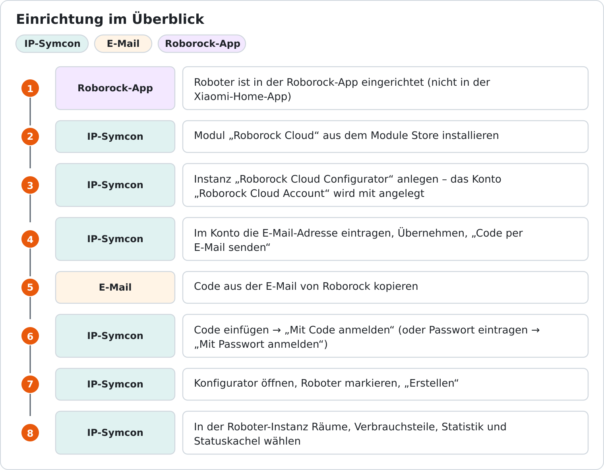
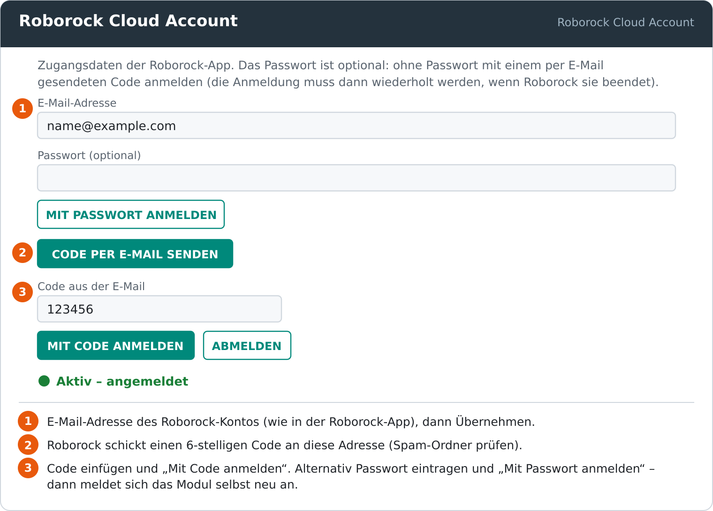
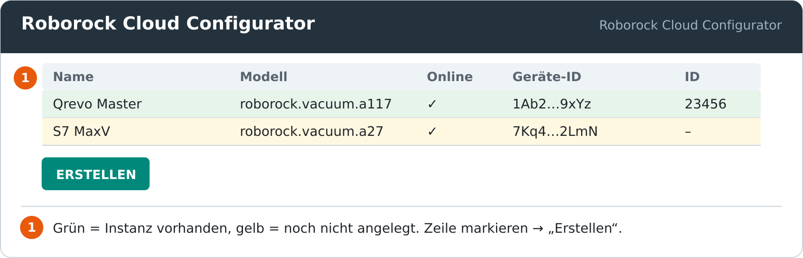
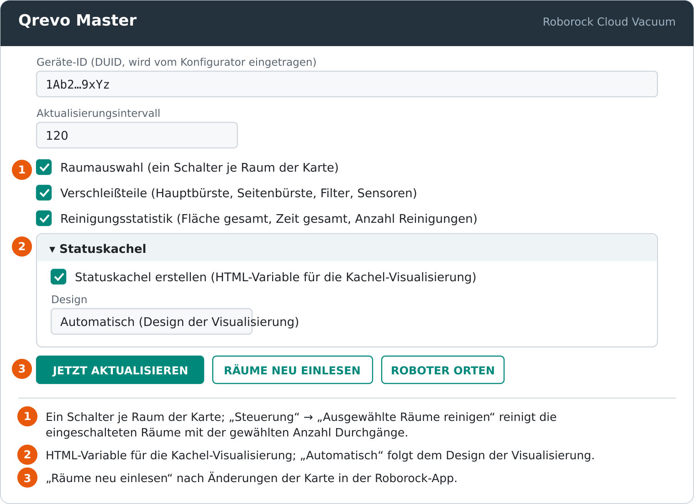

# Roborock Cloud für IP-Symcon – Anleitung (Deutsch)

Einbindung von Roborock-Saugrobotern in [IP-Symcon](https://www.symcon.de) über die Roborock-Cloud – denselben Dienst,
den die Roborock-App verwendet. Kein lokaler Zugriff auf den Roboter, kein ausgelesener Token, keine Zusatzhardware:
mit dem Roborock-Konto anmelden, Roboter im Konfigurator anlegen, fertig.

English version: [README.md](README.md)

---

## Inhalt

1. [Funktionen](#funktionen)
2. [Unterstützte Geräte](#unterstützte-geräte)
3. [Voraussetzungen](#voraussetzungen)
4. [Installation](#installation)
5. [Einrichtung Schritt für Schritt](#einrichtung-schritt-für-schritt)
6. [Die drei Module](#die-drei-module)
7. [Variablen der Saugroboter-Instanz](#variablen-der-saugroboter-instanz)
8. [Statuskachel](#statuskachel)
9. [Bedienung in der Visualisierung](#bedienung-in-der-visualisierung)
10. [Raumreinigung](#raumreinigung)
11. [PHP-Befehle und Beispiele](#php-befehle-und-beispiele)
12. [Funktionsweise und Abfragehäufigkeit](#funktionsweise-und-abfragehäufigkeit)
13. [Fehlersuche](#fehlersuche)
14. [Datenschutz und Sicherheit](#datenschutz-und-sicherheit)
15. [Grenzen](#grenzen)
16. [Versionen](#versionen)

---

## Funktionen

* Anmeldung mit E-Mail und Passwort **oder** mit einem Einmal-Code per E-Mail (Zwei-Faktor-Bestätigung)
* automatische Neuanmeldung mit dem hinterlegten Passwort, wenn Roborock die Sitzung beendet (höchstens alle 6 h)
* Konfigurator: alle Geräte des Kontos mit Modell, Online-Status und Geräte-ID, Instanzen per Klick anlegen
* je Roboter:
  * Zustand und Klartext-Status (z. B. *„Lädt zwischendurch, Reinigung wird fortgesetzt“*)
  * Akku, Fehler mit Klartext, Online
  * Saugleistung, Wassermenge, Wischmodus (nur wenn der Roboter sie meldet) – in der Visu umschaltbar
  * aktuelle bzw. letzte Reinigung: Dauer und Fläche
  * *Reinigungsauftrag offen* (Roboter lädt zwischendurch oder Reinigung pausiert)
  * Verschleißteile Hauptbürste, Seitenbürste, Filter, Sensoren in % – mit Zurücksetzen
  * Reinigungsstatistik: Fläche, Zeit und Anzahl gesamt
  * Lautstärke der Sprachausgabe
  * Befehle: Starten, Pause, Stopp, Zur Station, Fortsetzen, Orten, Staubbehälter entleeren, Mopp waschen
  * **Raumreinigung**: ein Schalter je Raum der Karte (Namen aus der App) und Durchgänge 1x/2x/3x
  * optionale **Statuskachel** (HTML) für die Kachel-Visualisierung, hell/dunkel/automatisch
  * beliebige weitere Roboter-Befehle über `RRV_SendCommand`

## Unterstützte Geräte

Alle **Saugroboter in der Roborock-App** mit Cloud-Protokoll **1.0**, z. B. S5 Max, S6 (MaxV), S7 (MaxV Ultra),
S8 (Pro/MaxV Ultra), Q5, Q7 (Max), Q8 Max, Qrevo, Qrevo S, Qrevo MaxV, Qrevo Master, Qrevo Pro.

Geräte mit anderem Protokoll (z. B. manche Nass-/Trockensauger, Waschmaschinen) zeigt der Konfigurator mit dem
Hinweis *„Protokoll … nicht unterstützt“*; sie lassen sich nicht anlegen.

**Xiaomi Home / Mi Home:** Roboter, die in der Xiaomi-App gekoppelt sind, liegen nicht in der Roborock-Cloud. Gerät in
Xiaomi Home entfernen und in der Roborock-App neu hinzufügen (WLAN-Reset am Roboter; die Karte bleibt meist erhalten,
Raumnamen und Zeitpläne müssen ggf. neu vergeben werden).

Getestet: Roborock Qrevo Master (`roborock.vacuum.a117`), S7 MaxV Ultra (`roborock.vacuum.a27`).

## Voraussetzungen

* IP-Symcon ab 7.0
* Roborock-App-Konto (Anmeldung mit E-Mail), Roboter darin hinzugefügt
* Internetzugang von IP-Symcon zu `*.roborock.com` (HTTPS 443, MQTT/TLS 8883)

## Installation

* **Module Store** (Korb-Symbol oben rechts in der Verwaltungskonsole): nach *Roborock Cloud* suchen und installieren, oder
* **Module Control:** URL `https://github.com/cbeham1/SymconRoborock` hinzufügen

Nicht beides gleichzeitig – der Store meldet sonst einen Konflikt.

> Die Bilder unten sind Schemabilder: Sie zeigen Felder und Reihenfolge, das Aussehen in Symcon weicht etwas ab.
> Namen, IDs und Adressen darin sind Beispiele.



## Einrichtung Schritt für Schritt

1. **Objekt hinzufügen → Instanz → „Roborock Cloud Configurator“** anlegen. Symcon legt dabei die übergeordnete
   Instanz **„Roborock Cloud Account“** an.
2. Konto-Instanz öffnen, **E-Mail-Adresse** der Roborock-App eintragen (Passwort optional), **Übernehmen**.
   Status: *„Bitte anmelden“*.
3. Anmelden:
   * **Mit Passwort anmelden**, oder
   * **Code per E-Mail senden** → Code aus der Mail eintragen → **Mit Code anmelden**.
   Bei einem neuen Client antwortet Roborock oft mit *„need two-step validate (2031)“* – dann den Code-Weg nehmen.
   Nach Erfolg erscheint *„Anmeldung erfolgreich – Geräte: …“*, die Instanz ist aktiv.

   
4. **Konfigurator** öffnen, unter *„Erstelle neue Instanzen in“* den Ort wählen, Roboter markieren → **Erstellen**.

   
5. Die neue Instanz **„Roborock Cloud Vacuum“** liest nach ca. 5 s den Status, lädt die Räume und erstellt die
   Statuskachel. Variable **„Statuskachel“** auf eine Kachel legen und die Kachelgröße im Bearbeiten-Modus anpassen.

   

## Die drei Module

### Roborock Cloud Account (Präfix `RRC`)

| Einstellung | Bedeutung |
|-------------|-----------|
| E-Mail-Adresse | Konto der Roborock-App |
| Passwort (optional) | für *Mit Passwort anmelden* und die automatische Neuanmeldung |

Schaltflächen: *Mit Passwort anmelden*, *Code per E-Mail senden*, *Mit Code anmelden*, *Abmelden* (löscht nur die in
der Instanz gespeicherte Anmeldung). Statuscodes: 102 angemeldet, 104 keine E-Mail, 201 bitte anmelden,
202 Anmeldung fehlgeschlagen, 203 keine Verbindung zur Cloud.

### Roborock Cloud Configurator (Präfix `RRK`)

Liste aller Geräte (Name, Modell, Online, Geräte-ID, Hinweis). Vorhandene Instanzen werden mit ID angezeigt und nicht
doppelt angelegt.

### Roborock Cloud Vacuum (Präfix `RRV`)

| Einstellung | Standard | Bedeutung |
|-------------|----------|-----------|
| Geräte-ID (DUID) | – | vom Konfigurator eingetragen |
| Aktualisierungsintervall | 120 s | Abstand der Statusabfragen (mind. 30 s) |
| Raumauswahl | an | Schalter je Raum + *Durchgänge* |
| Verschleißteile | an | Restlaufzeit in %, jede 30. Abfrage |
| Reinigungsstatistik | an | Summen, jede 30. Abfrage |
| Statuskachel erstellen | an | HTML-Variable *Statuskachel* |
| Design | Automatisch | Automatisch (wie das Design der Kachel-Visualisierung, sonst wie das Anzeigegerät), Dunkel, Hell |

Schaltflächen: *Jetzt aktualisieren*, *Räume neu einlesen* (nach Umbenennen/Teilen von Räumen in der App),
*Roboter orten*.

## Variablen der Saugroboter-Instanz

| Ident | Name | Typ | schaltbar | Inhalt |
|-------|------|-----|-----------|--------|
| `Tile` | Statuskachel | String | | HTML-Kachel |
| `StatusText` | Status | String | | Klartext-Zustand |
| `Control` | Steuerung | Integer | ✔ | Starten, Pause, Stopp, Zur Station, Fortsetzen, Ausgewählte Räume reinigen, Orten, Staubbehälter entleeren, Mopp waschen |
| `State` | Zustand | Integer | | Zustandscode (Liste unten) |
| `Battery` | Akku | Integer | | % |
| `Error` | Fehler | Integer | | 0 = kein Fehler |
| `FanPower` | Saugleistung | Integer | ✔ | 101 Leise, 102 Ausgeglichen, 103 Turbo, 104 Maximum, 105 Aus, 106 Benutzerdefiniert, 108 Max+, 110 SmartPlan |
| `WaterMode` | Wassermenge | Integer | ✔ | 200 Aus, 201 Niedrig, 202 Mittel, 203 Hoch, 204 Benutzerdefiniert, 207 Benutzerdef. Stufe, 209 SmartPlan |
| `MopMode` | Wischmodus | Integer | ✔ | 300 Standard, 301 Gründlich, 302 Benutzerdefiniert, 303 Gründlich+, 304 Schnell, 306 SmartPlan |
| `CleanTime` | Reinigungsdauer | Integer | | Minuten der aktuellen/letzten Reinigung |
| `CleanArea` | Gereinigte Fläche | Float | | m² der aktuellen/letzten Reinigung |
| `TaskOpen` | Reinigungsauftrag offen | Boolean | | Roboter lädt zwischendurch bzw. Reinigung pausiert |
| `Online` | Online | Boolean | | Roboter hat geantwortet |
| `Volume` | Lautstärke | Integer | ✔ | 0–100 % |
| `MainBrush`, `SideBrush`, `Filter`, `Sensors` | Verschleißteile | Integer | | Rest in % |
| `TotalArea`, `TotalTime`, `TotalCount` | Statistik | Float/Float/Integer | | m², h, Anzahl |
| `Repeat` | Durchgänge | Integer | ✔ | 1x / 2x / 3x |
| `Room<Segment>` | Raumname | Boolean | ✔ | Raumauswahl, z. B. `Room23` |

**Zustände:** 1 Startet, 2 Von Station getrennt, 3 Bereit, 4 Fernsteuerung, 5 Reinigt, 6 Fährt zur Station,
7 Manueller Modus, 8 Lädt, 9 Ladeproblem, 10 Pausiert, 11 Punktreinigung, 12 Fehler, 13 Fährt herunter,
14 Software-Update, 15 Dockt an, 16 Fährt zum Zielpunkt, 17 Zonenreinigung, 18 Raumreinigung,
22 Staubbehälter wird entleert, 23/25 Mopp wird gewaschen, 26 Fährt zum Moppwaschen, 28 Im Gespräch, 29 Kartierung,
32 Patrouille, 33/34 Mopp wird angebracht/abgelegt, 100 Voll geladen, 101 Offline.

**Fehler (Auszug):** 1 Lasersensor blockiert, 2 Stoßfänger klemmt, 3 Räder in der Luft, 4 Absturzsensor,
5 Hauptbürste blockiert, 6 Seitenbürste blockiert, 7 Räder blockiert, 8 Roboter steckt fest, 9 Staubbehälter fehlt,
12 Akku schwach, 13 Ladefehler, 14 Akkufehler, 15 Wandsensor verschmutzt, 16 Roboter schräg, 17 Seitenbürsten-Fehler,
18 Lüfterfehler, 22 Station nicht gefunden, 23 Rückkehr fehlgeschlagen, 24 Sperrzone, 27 VibraRise blockiert,
28 Roboter auf Teppich, 29 Filter verstopft, 30 Unsichtbare Wand, 31 Teppich nicht überquerbar, 32 Interner Fehler.

## Statuskachel

* Kopf mit Symbol, Name und Zustands-Abzeichen (Reinigt / In der Station / Fehler / Offline)
* farbige Oberkante: grün bereit/lädt, blau reinigt/fährt, orange pausiert oder Auftrag offen, rot Fehler, grau offline
* Akku-Ring (⚡ beim Laden), Status groß, während der Reinigung Dauer und Fläche
* Info-Kacheln: Saugleistung, Wassermenge, Wischmodus, aktuelle/letzte Reinigung
* rotes Banner mit Fehlertext
* Wartungsbalken der Verschleißteile (grün > 25 %, orange ≤ 25 %, rot ≤ 10 %)
* Raum-Chips (ausgewählte Räume hervorgehoben) und Durchgänge
* Fußzeile mit Verbindung und Uhrzeit der letzten Aktualisierung

Die Kachel passt Schrift und Ring an ihre Größe an; bei kleinen Kacheln fallen Räume und Wartung weg. Sie wird nach
jeder Abfrage und sofort nach Änderungen an Raumauswahl, Durchgängen oder Einstellungen neu aufgebaut.

## Bedienung in der Visualisierung

* **Steuerung** – Befehle als Knöpfe. *Fortsetzen* setzt eine unterbrochene Reinigung passend fort (ganze Wohnung,
  Zonen oder Räume).
* **Saugleistung / Wassermenge / Wischmodus / Lautstärke** – wirken sofort am Roboter.
* **Raum-Schalter + Durchgänge** – wählen die Räume für *Ausgewählte Räume reinigen*; das Umschalten selbst sendet
  keinen Befehl.

Nicht jeder Roboter kann jede Stufe; unbekannte Werte lehnt der Roboter ab (*„Befehl fehlgeschlagen“*).

## Raumreinigung

Die Räume kommen aus der Karte des Roboters (`get_room_mapping`) und den Raumnamen des Zuhauses in der App. Je Raum
entsteht ein Schalter mit Ident `Room<Segment>`. Nach Umbenennen, Teilen oder Zusammenlegen von Räumen in der App
**Räume neu einlesen** – Namen werden angepasst, Schalter nicht mehr vorhandener Räume entfernt.

## PHP-Befehle und Beispiele

```php
RRV_Start($id);  RRV_Pause($id);  RRV_Stop($id);  RRV_ReturnToDock($id);
RRV_Resume($id);                              // unterbrochene Reinigung fortsetzen
RRV_CleanRooms($id, '23,25', 2);              // Segmente 23 und 25, zwei Durchgänge
RRV_CleanSelectedRooms($id);                  // eingeschaltete Raum-Schalter, Durchgänge aus "Repeat"
RRV_Locate($id);  RRV_EmptyDustBin($id);  RRV_WashMop($id);
RRV_SetFanPower($id, 104);  RRV_SetWaterMode($id, 202);  RRV_SetMopMode($id, 300);  RRV_SetVolume($id, 60);
RRV_ResetConsumable($id, 'Filter');           // MainBrush, SideBrush, Filter, Sensors
RRV_Update($id);  echo RRV_LoadRooms($id);
echo RRV_SendCommand($id, 'get_status', '[]'); // beliebige Methode, Antwort als JSON
```

Alle Befehle liefern `false`, wenn der Roboter ablehnt oder nicht antwortet; Details stehen im Debug und im Meldungslog.

Beispiel – Meldung, wenn der Sauger einen Fehler hat (Ereignis auf Änderung von *Fehler*):

```php
$error = GetValue(IPS_GetObjectIDByIdent('Error', $id));
if ($error > 0) {
    $text = GetValueString(IPS_GetObjectIDByIdent('StatusText', $id));
    // z. B. Push-Nachricht senden
}
```

## Funktionsweise und Abfragehäufigkeit

1. **Anmeldung** liefert ein Token und die Zugangsdaten für die Geräte-Cloud (Regionsserver aus der E-Mail-Adresse).
2. **Geräteliste** per signierter HTTPS-Anfrage (1 h zwischengespeichert).
3. **Befehle und Status** als verschlüsselte RPC-Nachrichten über MQTT (TLS): je Anfrage eine kurze Verbindung,
   bis zu 10 Befehle, je Befehl max. 10 s Wartezeit; je Konto immer nur eine MQTT-Verbindung gleichzeitig.
4. **Abfragen je Roboter:** alle *Aktualisierungsintervall* Sekunden `get_status` + `get_sound_volume`; jede 30. Abfrage
   zusätzlich Verschleißteile und Statistik; 4 s nach jedem Befehl erneut `get_status`. Antwortet der Roboter nicht,
   werden Zustand/Akku/Fehler aus der Cloud-Geräteliste übernommen und *Online* = aus.

## Fehlersuche

| Meldung / Verhalten | Ursache | Abhilfe |
|---------------------|---------|---------|
| *username or password error (2012)* | E-Mail/Passwort falsch oder Roboter in anderem Konto | Zugangsdaten der Roborock-App prüfen |
| *need two-step validate (2031)* | Roborock will den neuen Client bestätigen | *Code per E-Mail senden* → *Mit Code anmelden* |
| Konto nach Wochen *„Bitte anmelden“* | Sitzung abgelaufen, kein Passwort hinterlegt | neu anmelden oder Passwort eintragen |
| *MQTT-Anmeldung abgelehnt* | Zugang ungültig | mit Passwort automatisch, sonst manuell neu anmelden |
| Konfigurator leer | Konto nicht angemeldet | zuerst anmelden |
| *Protokoll … nicht unterstützt* | neueres Geräteprotokoll | in dieser Version nicht möglich |
| Roboter *Offline* | schläft / kein WLAN | WLAN prüfen, in der App aufwecken |
| Raum-Schalter heißen *Schlafzimmer1* … | Räume in der App nicht benannt | in der App benennen, *Räume neu einlesen* |
| Knöpfe zeigen Stufen, die der Roboter nicht hat | Profile enthalten die Werte aller Modelle | ignorieren oder in der Visu ausblenden |

Die **Debug-Ausgabe** von Konto- und Sauger-Instanz zeigt jede HTTPS-Anfrage (ohne Zugangsdaten), jeden RPC-Befehl und
die Antwort.

## Datenschutz und Sicherheit

* E-Mail und Passwort liegen als Eigenschaften in der Konto-Instanz, das Token in einem Attribut; *Abmelden* löscht die
  gespeicherte Anmeldung.
* Jede Konto-Instanz hat eine eigene zufällige Client-ID.
* Alle Verbindungen verschlüsselt (HTTPS, MQTT über TLS mit Zertifikatsprüfung); als Regionsserver werden nur
  `*.roborock.com`-Adressen akzeptiert.
* Daten gehen ausschließlich an die Roborock-Cloud.

## Grenzen

* keine Kartendarstellung im Modul (Abruf über `get_map_v1` möglich, Darstellung nicht enthalten)
* keine Zonen-/Punktreinigung mit Koordinaten, keine Zeitpläne (über `RRV_SendCommand` möglich)
* nur Cloud: ohne Internet kein Status und keine Befehle
* die Roborock-Cloud-API ist nicht offiziell dokumentiert und kann sich jederzeit ändern

## Versionen

| Version | Datum | Änderungen |
|---------|-------|------------|
| 1.6 | 17.11.2026 | Durchgänge als Auswahlknöpfe (Profil ohne Wertebereich) |
| 1.5 | 17.11.2026 | Durchgänge mit Zuordnungen 1x/2x/3x |
| 1.4 | 17.11.2026 | Lautstärke (Variable, `RRV_SetVolume`) |
| 1.3 | 17.11.2026 | Reinigungsstatistik, `RRV_ResetConsumable` |
| 1.2 | 17.11.2026 | kürzerer deutscher Text „Benutzerdef. Stufe“ |
| 1.1 | 17.11.2026 | Statuskachel im Kartendesign |
| 1.0 | 17.11.2026 | erste Version: Konto, Konfigurator, Saugroboter mit Statuskachel |

Lizenz: MIT ([LICENSE](LICENSE)). Roborock ist eine Marke der Beijing Roborock Technology Co., Ltd.; dieses Projekt
steht in keiner Verbindung zu Roborock.
