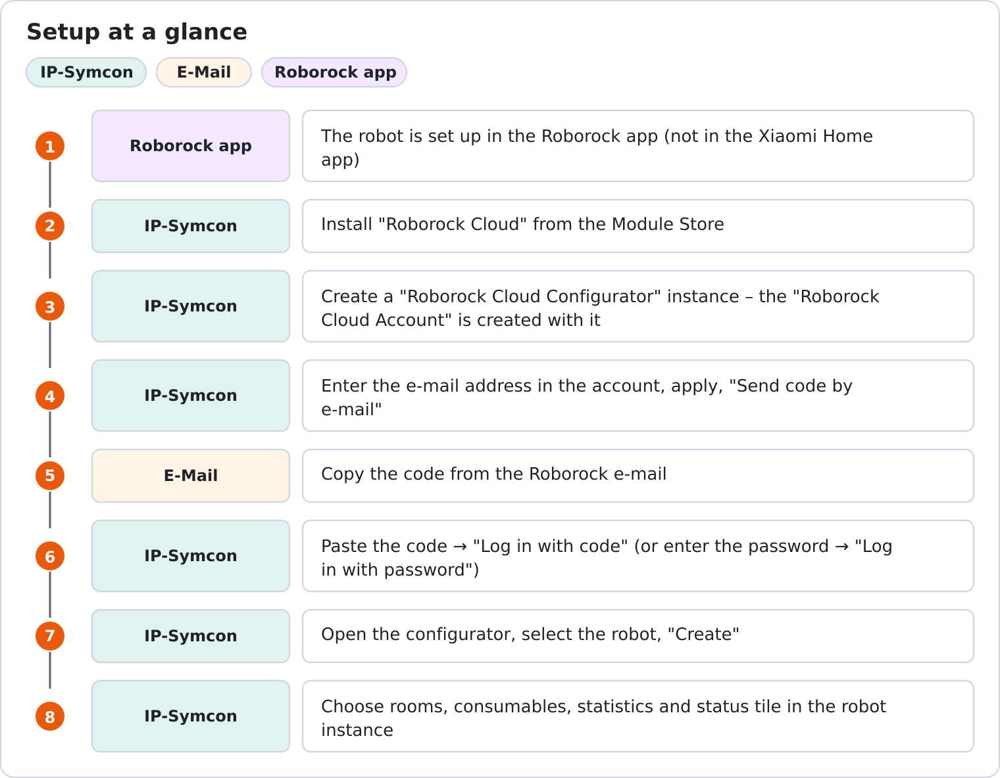
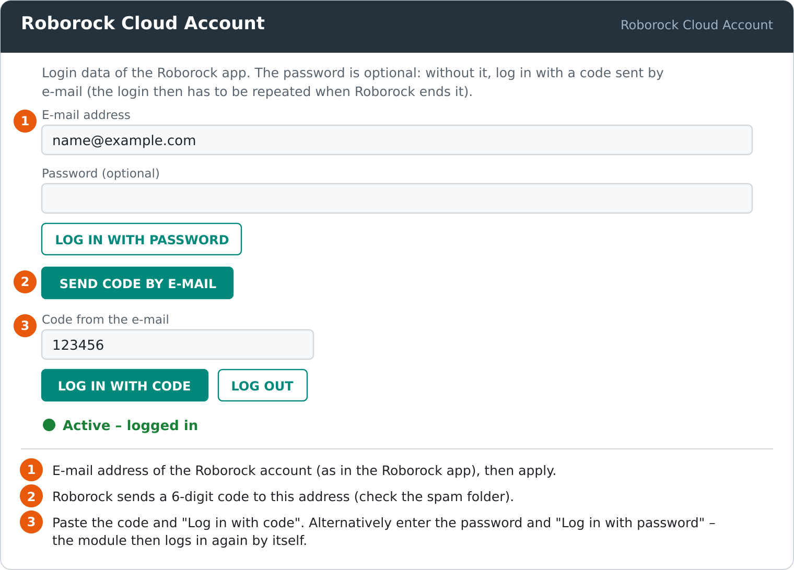
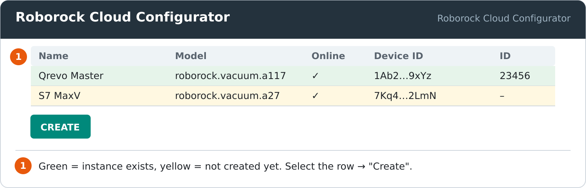
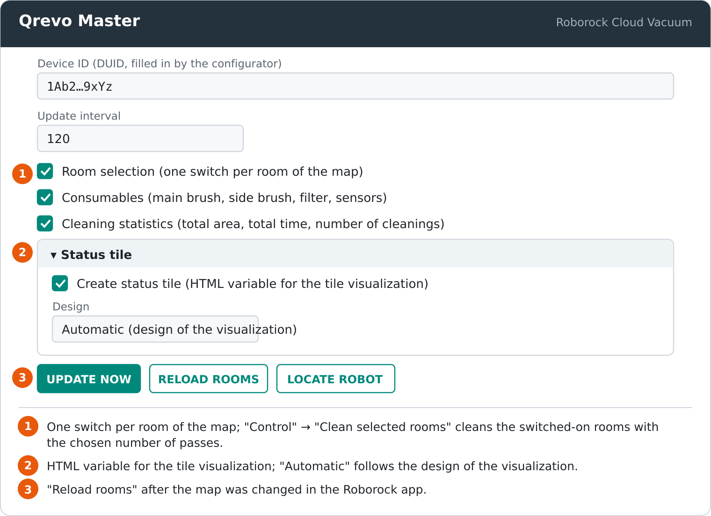

# Roborock Cloud for IP-Symcon

Integration of Roborock robot vacuums into [IP-Symcon](https://www.symcon.de) via the Roborock cloud – the same
service the Roborock app uses. No local network access to the robot, no extracted tokens and no extra hardware are
needed: log in with your Roborock account, pick the robot in the configurator, done.

**Deutsch:** siehe [README.de.md](README.de.md) (ausführliche Anleitung auf Deutsch).

---

## Contents

1. [Features](#features)
2. [Supported devices](#supported-devices)
3. [Requirements](#requirements)
4. [Installation](#installation)
5. [Setup step by step](#setup-step-by-step)
6. [Modules](#modules)
7. [How it works](#how-it-works)
8. [Status tile](#status-tile)
9. [Scripting examples](#scripting-examples)
10. [Troubleshooting](#troubleshooting)
11. [Privacy and security](#privacy-and-security)
12. [Limitations](#limitations)
13. [Changelog](#changelog)
14. [License and credits](#license-and-credits)

---

## Features

* Login with e-mail + password **or** with a one-time code sent by e-mail (two-step verification supported)
* Automatic new login with the stored password when Roborock ends the session (at most every 6 hours)
* Configurator lists all devices of the account (model, online state, device ID) and creates the instances
* Per robot:
  * state (starting, cleaning, room cleaning, returning, charging, washing the mop, error, …) and a plain-text status
    such as *"Recharging, cleaning will continue"*
  * battery, error code with text, online state
  * suction power, water flow and mop mode (only if the robot reports them) – switchable from the visualization
  * current/last cleaning: duration and area
  * "cleaning task not finished" (robot recharges in the middle of a cleaning or the cleaning was paused)
  * consumables: main brush, side brush, filter, sensors (remaining lifetime in %) and reset
  * cleaning statistics: total area, total time, number of cleanings
  * voice volume
  * commands: start, pause, stop, return to dock, resume, locate, empty dust bin, wash mop
  * **room cleaning**: one switch per room of the map (names from the app) plus number of passes (1x/2x/3x)
  * optional **status tile** (HTML) for the tile visualization – light, dark or automatic design
  * any other RPC method via `RRV_SendCommand` for your own scripts
* German and English user interface

## Supported devices

All Roborock **robot vacuums** that are used with the **Roborock app** and use cloud protocol version **1.0**, e.g.

| Series | Examples (non exhaustive) |
|--------|---------------------------|
| S | S5 Max, S6, S6 MaxV, S7, S7 MaxV (Ultra), S8, S8 Pro Ultra, S8 MaxV Ultra |
| Q | Q5, Q7, Q7 Max, Q8 Max |
| Qrevo | Qrevo, Qrevo S, Qrevo MaxV, Qrevo Master, Qrevo Pro |

The configurator also lists devices with other protocols (e.g. some wet/dry vacuums, washing machines). They are
marked *"Protocol … not supported"* and cannot be created.

Robots that are still paired with the **Xiaomi Home / Mi Home** app are **not** in the Roborock cloud. Remove the robot
from Xiaomi Home and add it in the Roborock app (the map usually stays on the robot; room names may have to be set again).

Tested with: Roborock Qrevo Master (`roborock.vacuum.a117`) and S7 MaxV Ultra (`roborock.vacuum.a27`).

## Requirements

* IP-Symcon 7.0 or newer
* Roborock app account (e-mail login) with the robot added
* Internet access from IP-Symcon to `*.roborock.com` (HTTPS 443, MQTT over TLS 8883)

## Installation

* **Module Store** (basket icon at the top right of the management console): search for *Roborock Cloud* and install, or
* **Module Control:** add the URL `https://github.com/cbeham1/SymconRoborock`

Not both at the same time – the store reports a conflict otherwise.

> The pictures below are schematic: they show the fields and their order, Symcon looks slightly different.
> Names, IDs and addresses in them are examples.



## Setup step by step

1. **Objects → Add object → Instance → "Roborock Cloud Configurator".**
   IP-Symcon asks for the parent and creates a **"Roborock Cloud Account"** instance.
2. Open the account instance, enter the **e-mail address** of the Roborock app (password optional) and press
   **Apply changes**. The status changes to *"Please log in"*.
3. Log in:
   * **Log in with password** – works if Roborock does not ask for a verification, or
   * **Send code by e-mail** → enter the code from the mail → **Log in with code**.
     Roborock answers new clients with *"need two-step validate (2031)"* – then use the code.
   After a successful login the message lists the devices of the account and the status is *active*.

   
4. Open the **configurator**, select a robot and press **Create**.

   
5. The new **"Roborock Cloud Vacuum"** instance reads the status after ~5 s, loads the rooms of the map and creates the
   status tile. Put the variable **"Status tile"** on a tile of the tile visualization and size the tile in edit mode.

   

## Modules

| Module | Type | Prefix | Description |
|--------|------|--------|-------------|
| [Roborock Cloud Account](RoborockCloud/README.md) | I/O | `RRC` | Login, HTTPS device list, MQTT RPC to the robots |
| [Roborock Cloud Configurator](RoborockConfigurator/README.md) | Configurator | `RRK` | Lists the devices, creates the vacuum instances |
| [Roborock Cloud Vacuum](RoborockVacuum/README.md) | Device | `RRV` | Status, commands, rooms, consumables, status tile |

## How it works

```
 Roborock Cloud Vacuum ──(get_status, commands)──┐
 Roborock Cloud Vacuum ──────────────────────────┤  ForwardData
 Roborock Cloud Configurator ──(device list)─────┤
                                                 ▼
                                   Roborock Cloud Account
                                   │                    │
               HTTPS (login, home, devices)     MQTT over TLS (RPC)
                                   ▼                    ▼
                          Roborock cloud  ──────────►  robot
```

1. **Login** (`/api/v1/login` or `/api/v1/loginWithCode`) returns a token and the *rriot* credentials
   (user, key, region servers). The region server is determined from the e-mail address (`getUrlByEmail`).
2. **Device list:** `getHomeDetail` → home ID, then the signed (Hawk) request `/v3/user/homes/<id>` returns devices,
   rooms and products (cached for one hour, refreshed when a device is unknown).
3. **Commands and status** are sent as encrypted RPC messages via MQTT (topic `rr/m/i/…` → robot, answer on `rr/m/o/…`).
   Each request opens one short TLS connection, sends up to 10 calls, waits up to 10 s per answer and disconnects.
   Only one MQTT session per account runs at a time (semaphore).
4. **Status polling** of each vacuum: `get_status` and `get_sound_volume` every *update interval* (default 120 s, minimum
   30 s); every 30th update additionally `get_consumable` and `get_clean_summary`. After a command the status is read
   again after 4 s. If the robot does not answer (offline/sleeping), the state of the cloud device list is used.

The protocol was reimplemented following the open source project
[python-roborock](https://github.com/Python-roborock/python-roborock). No code of that project is included.

## Cleaning tile

The vacuum instance itself is a tile of the tile visualization (HTML-SDK, since 1.8): link the **instance** on a page
and give it a large tile. It adapts to its size:

* **middle:** floor buttons if the robot has several maps (switching loads the map, rooms are read again), map – optional property *Map* (an HTML box containing an image of the map, e.g. from a map script, or an
  image object); can be rotated in 90° steps (property *Rotate map*)
* **left:** big main button (*Clean rooms (n)* with selected rooms, otherwise *Clean everything*; *Pause* while
  cleaning, *Resume* for an interrupted task), buttons *Stop*, *Dock*, *Locate*, room selection as tiles,
  suction power / water flow / mop mode as buttons (easy to use on wall tablets), passes 1×/2×/3×
* **right:** picture of the robot (optional property *Picture of the robot*, otherwise an illustration: robot with multifunction station, auto-empty dock or charging dock), battery ring and state, error banner, last cleaning (duration, area), statistics, maintenance bars with *Reset* (tap twice to confirm),
  time of the last update (also as variable *Last update*, written after every successful query)

Narrower tiles put the map on top and the two columns below; on very small tiles everything is stacked. Commands go
directly to the robot (same as the variables). Design as for the status tile (*Automatic* follows the design of the
tile visualization).

## Status tile

When *"Create status tile"* is enabled, the vacuum instance writes an HTML variable **"Status tile"** (`~HTMLBox`):

* header with robot icon, name and a state badge (cleaning / at the dock / error / offline)
* colored top border by state: green = ready/charging, blue = cleaning/returning, orange = paused or task not
  finished, red = error, grey = offline
* battery ring (with ⚡ while charging), big status text, duration and area while cleaning
* info tiles: suction power, water flow, mop mode, current/last cleaning
* red banner with the error text
* maintenance bars for the consumables (green > 25 %, orange ≤ 25 %, red ≤ 10 %)
* room chips (selected rooms highlighted) and number of passes
* footer with connection and update time

The tile scales with its size (container units); on small tiles rooms and maintenance are hidden automatically.
Design: *Automatic* follows light/dark mode of the viewing device, or fixed *Dark* / *Light*.

## Scripting examples

```php
$vacuum = 12345; // ID of the Roborock Cloud Vacuum instance

// Clean kitchen (segment 23) and hallway (segment 25) twice
RRV_CleanRooms($vacuum, '23,25', 2);

// Clean the rooms whose switches are on, using the "Passes" variable
RRV_CleanSelectedRooms($vacuum);

// Quiet mode, then start whole-home cleaning
RRV_SetFanPower($vacuum, 101);
RRV_Start($vacuum);

// Continue an interrupted cleaning (whole home, zones or rooms)
RRV_Resume($vacuum);

// Back to the dock
RRV_ReturnToDock($vacuum);

// Read the raw status
$answer = json_decode(RRV_SendCommand($vacuum, 'get_status', '[]'), true);
var_dump($answer['result'][0]['in_cleaning'] ?? null);

// Reset the filter counter after replacing the filter
RRV_ResetConsumable($vacuum, 'Filter');
```

Segment IDs of the rooms are the numbers in the idents of the room switches (`Room23` = segment 23).

## Troubleshooting

| Message / symptom | Cause | Solution |
|-------------------|-------|----------|
| `username or password error (2012)` | wrong e-mail or password, or the robot is in a different Roborock account | check the login data; use the e-mail of the Roborock app |
| `need two-step validate (2031)` | Roborock wants to verify the new client | *Send code by e-mail* → *Log in with code* |
| Status *Please log in* after some weeks | Roborock ended the session, no password stored | log in again (or store the password for automatic login) |
| `MQTT login rejected` | credentials no longer valid | the module logs in again automatically (with password); otherwise log in manually |
| Configurator empty | account instance not active | log in first |
| `Protocol B01 … not supported` | device uses a newer protocol | not supported by this version |
| Robot *Offline* / *No answer from the robot* | robot sleeps or has no Wi-Fi; the cloud list is used | check Wi-Fi, wake the robot in the app |
| Room switches with names like *Bedroom1* | rooms are not named in the app | rename the rooms in the Roborock app, then *Reload rooms* |
| Button shows values the robot does not have (e.g. Max+) | the profiles contain the values of all models | ignore or hide them in the visualization |

Use the **debug output** of the account and vacuum instances: every HTTPS path, RPC call and answer is logged there
(without passwords and tokens).

## Privacy and security

* E-mail and password are stored as properties of the account instance (like other IP-Symcon modules), the login
  token in an attribute of the instance. *Log out* deletes the stored login.
* Each account instance uses its own random client ID (`header_clientid`).
* All connections are encrypted (HTTPS, MQTT over TLS with certificate check). The region server must be a
  `*.roborock.com` host.
* No data is sent anywhere except to the Roborock cloud.

## Limitations

* No map display (the map can be fetched with `get_map_v1`, but rendering is not part of this module).
* No zone or spot cleaning with coordinates, no scheduling, no do-not-disturb settings (possible via `RRV_SendCommand`).
* Cloud only: without Internet no status and no commands.
* The Roborock cloud API is not officially documented; Roborock may change it at any time.

## Changelog

| Version | Date | Changes |
|---------|------|---------|
| 1.6 | 17.11.2026 | Passes as selection buttons (profile without value range) |
| 1.5 | 17.11.2026 | Passes profile with associations 1x/2x/3x |
| 1.4 | 17.11.2026 | Voice volume (variable, `RRV_SetVolume`) |
| 1.3 | 17.11.2026 | Cleaning statistics (total area/time/count), `RRV_ResetConsumable` |
| 1.2 | 17.11.2026 | Shorter German text for the custom water level |
| 1.1 | 17.11.2026 | Status tile in card design (battery ring, info tiles, maintenance, rooms) |
| 1.0 | 17.11.2026 | First version: account, configurator, vacuum with status tile |

## License and credits

MIT, see [LICENSE](LICENSE).
Protocol knowledge: [python-roborock](https://github.com/Python-roborock/python-roborock) (GPL-3.0, only the protocol
was reimplemented). Roborock is a trademark of Beijing Roborock Technology Co., Ltd.; this project is not affiliated
with Roborock.
